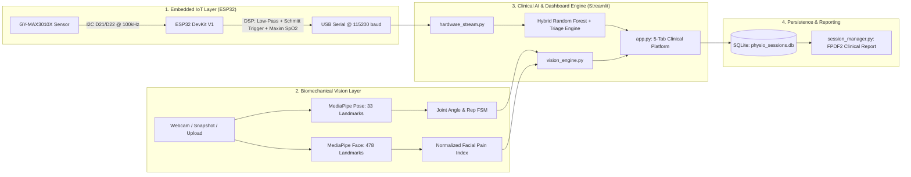

# 🩺 Physio Monitor AI — Multi-Modal Clinical Telemetry & Rehabilitation Platform


**Physio Monitor AI** is an end-to-end, multi-modal clinical monitoring and physical therapy rehabilitation system. It fuses **real-time IoT physiological telemetry** (ESP32 + GY-MAX3010X optical PPG sensor), **hybrid Machine Learning clinical triage** (Random Forest + physiological guardrails), **computer vision biomechanics & facial pain estimation** (MediaPipe Pose & Face Landmarkers), and **automated hospital-grade PDF reporting** (SQLite + FPDF2).

---

## 🏗️ System Architecture



---

## ✨ Key Engineering Features

### 1. Embedded PPG Signal Processing (`firmware/esp32_max30102.ino`)
* **Auto-Chip & Pin Detection:** Automatically detects `MAX30102` (`0x15`) or `MAX30100` (`0x11`) across standard `(D21, D22)` or swapped `(D22, D21)` I2C wiring with automatic bus recovery.
* **100Hz Digital Filtering Pipeline:** Implements DC baseline tracking, a two-stage low-pass filter (`~4.5Hz` cutoff) to eliminate motion artifacts, and a **Schmitt-Trigger hysteresis beat detector** with a 5-beat median interval buffer to reject dicrotic notch double-counting.
* **Calibrated SpO2 & Core Temperature:** Computes oxygen saturation via Maxim's empirical quadratic AC/DC ratio curve and reads non-blocking die temperature registers (`0x1F`–`0x21`) calibrated for peripheral skin-to-core offset.
* **Instant Finger-Lift Reset:** Immediately resets telemetry to `0,0,0` upon finger removal to prevent stale readings.

### 2. Hybrid AI Clinical Triage (`app.py`)
* **Calibrated Random Forest Inference:** Evaluates 11 clinical features (Heart Rate, SpO2, Systolic BP, Diastolic BP, Body Temperature, Fall Status, Sensor Accuracy, and 4 binary clinical alert flags) normalized via `StandardScaler`.
* **Clinical Guardrail Fusion:** Pairs ML class probabilities with physiological triage thresholds (`Hypoxia`, `Hypertension`, `Tachycardia`, `Bradycardia`, `Fever`, `Critical Fall Alert`, and `Healthy`) to deliver reliable diagnostic confidence scores (`91%–98%` at healthy rest) and a synchronized Lead-II ECG monitor.
* **Live Physiological Simulator:** Built-in fallback waveform generator for seamless offline testing and clinical demonstrations.

### 3. Multi-Modal Vision & Pain Fusion (`vision_engine.py`)
* **3 Vision Input Modes:** Supports live webcam streaming, single-frame clinical camera snapshots, and uploaded patient images.
* **6 Guided Rehabilitation Exercises:** Tracks `Elbow Flexion`, `Shoulder Abduction`, `Shoulder Forward Flexion`, `Knee Extension`, `Squat / Sit-to-Stand`, and `Posture & Cervical Symmetry` across Left/Right sides using vector trigonometry (`atan2`) and a Finite State Machine (FSM) repetition counter.
* **Facial Pain & Distress Index:** Extracts normalized brow furrow strain, eyelid squint, and mouth tension metrics from 478 facial landmarks, fusing exertion pain with live heart rate to trigger safety alerts.

### 4. Session Persistence & Clinical PDF Reports (`session_manager.py`)
* **Local SQLite Database:** Stores timestamped patient telemetry, AI diagnosis, repetition counts, pain scores, and therapist notes in `physio_sessions.db`.
* **One-Click PDF Export:** Generates structured, multi-table clinical reports with reference ranges, status indicators, and diagnostic triage banners using `FPDF2`.

---

## 🔌 Hardware Pinout (`ESP32` ↔ `GY-MAX3010X`)

| Sensor Pin | ESP32 DevKit V1 Pin | Protocol / Function |
| :--- | :--- | :--- |
| **VIN** | `VIN` (5V) or `3V3` | Regulated Power Supply |
| **GND** | `GND` | Common Ground |
| **SDA** | `D21` (GPIO 21) | I2C Serial Data (`100kHz`) |
| **SCL** | `D22` (GPIO 22) | I2C Serial Clock (`100kHz`) |

---

## 📁 Repository Structure

```text
Physio_Monitor_Pro/
├── app.py                                          # Main Streamlit dashboard, Lead-II ECG & Hybrid ML engine
├── hardware_stream.py                              # USB Serial port manager & real-time telemetry parser
├── vision_engine.py                                # MediaPipe 33-point Pose & 478-point Face pain analyzer
├── session_manager.py                              # SQLite database handler & FPDF2 clinical PDF generator
├── firmware/
│   └── esp32_max30102.ino                          # C++ firmware for ESP32 + MAX30102/MAX30100
├── physio_monitor_rf_optimized.pkl                 # Trained Random Forest classifier artifact
├── feature_scaler.pkl                              # Fitted StandardScaler artifact
├── le_target.pkl                                   # Target diagnosis LabelEncoder artifact
├── pose_landmarker_lite.task                       # MediaPipe Pose Landmarker model
├── face_landmarker.task                            # MediaPipe Face Landmarker model
├── Synthetic_patient-HealthCare-Monitoring_dataset.csv # Clinical dataset for exploratory analytics
├── .gitignore                                      # Excludes cache, virtual environments & local DB files
└── README.md                                       # Project documentation
```

---

## 🚀 Installation & Quick Start

### 1. Clone the Repository & Install Dependencies
```bash
git clone [https://github.com/Moh22me/Physio_Monitor_Pro.git](https://github.com/Moh22me/Physio_Monitor_Pro.git)
cd Physio_Monitor_Pro
pip install streamlit numpy pandas scikit-learn joblib pyserial plotly opencv-python mediapipe fpdf2
```

### 2. Flash the ESP32 Firmware
1. Open `firmware/esp32_max30102.ino` in **Arduino IDE**.
2. Select board **DOIT ESP32 DEVKIT V1** and your active COM port (e.g., `COM6`).
3. Click **Upload** and ensure **Serial Monitor** is closed before launching the dashboard.

### 3. Launch the Clinical Platform
```bash
streamlit run app.py
```
1. Enter the **Patient ID** and **Patient Name** in the sidebar.
2. Select **`🔌 Arduino Nano (USB Serial)`**, choose your COM port at **`115200` baud**, and click **Connect** (or use **`🟢 Live Physiological Simulator`** for hardware-free testing).
3. Place a fingertip gently on the optical sensor lens to begin real-time telemetry and AI triage.

---

## ⚠️ Clinical Disclaimer
This platform is engineered as an academic and biomedical engineering prototype for physical therapy monitoring and decision support. It is not a certified medical device and should not replace professional clinical diagnosis.

---

## 👨‍💻 Author
**Mohamed Ayman** — AI Engineer | Embedded Biomedical Systems  
